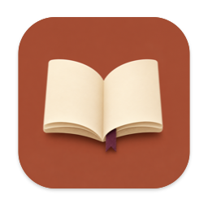

<p align="center"></p>

# PageWise

一本论文读到一半，你在页边留下一个问题。几周后读到另一篇，你还可以找到当时那句话，比较两次实验的条件，把新的判断写回笔记。PageWise 把英文论文、中文译文、带出处的讨论和这些阅读笔记放在同一座书架上。

**macOS 15+ · Apple 芯片及 Intel · iPadOS 18+ 可从源码构建**

[下载 Mac 版](https://github.com/Hean-Yi/PageWise/releases/latest) · [阅读指南](docs/reader-guide.md) · [研究记忆的工作方式](docs/agent-memory.md)

## 从两页论文开始

1. 打开 DMG，将 **PageWise** 拖入「应用程序」。第一次打开空书库时，点「直接试读示例」，即可打开内置的 *When the Average Misleads*。阅读、划线和写笔记都可以离线完成。
2. 试着回答这个问题：**两个系统在每个难度组里比较，为什么总分排名会反过来？** 拖选一句话，点「添加笔记」记下自己的解释。笔记支持 Markdown、公式和指向其他本地笔记的链接。
3. 想读译文或追问对照条件，在「设置 → 模型服务」选择服务商、保存自己的密钥。点「双语重排」边读边译，或打开右侧「论文助读」，点「AI 精读」。每条通过核对的批注都能回到原文。

「帮助 → 快速上手」和应用内设置都能重看引导。Mac 试用包采用本地签名，尚未经过 Apple 公证。可在发布页核对 SHA-256，首次打开请参照系统提示。[Apple 的打开说明](https://support.apple.com/zh-cn/102445)

## 读到哪里，证据就留在哪里

| 阅读时想做的事 | 在 PageWise 里的入口 |
| --- | --- |
| 找论文，再决定读哪篇 | 拖入 PDF，或在书架查 arXiv、Crossref、DBLP。开放全文可一键导入。Mac 指针停在封面上按住空格，即可预览摘要和已有的精读概括。 |
| 连续读双语正文 | 本地 PDF 按段排版，当前页优先翻译。在线 arXiv 论文优先使用同版 TeX 或 HTML。公式、表格和原始 PDF 可回查。 |
| 细看一个结论 | 助读把论点、概念、数据、异议和方法标在具体原句旁。文末笔记串起关键对照、替代解释和仍缺的证据。 |
| 接上自己的研究 | 在「书库助理」里问“我在哪几篇笔记里追问过同一个问题？” 可回查来源。两处助理共用你明确交代的回答习惯。空闲时，所选模型会整理有关联的记忆，之后的对话直接使用新版；本地中英语义检索模型已随应用内置，可在「设置 → 研究记忆」修改来源或关闭自动整理。 |
| 把笔记带走 | 「阅读笔记」按论文收拢文末笔记和批注，点正文即可编辑。「整理到 Obsidian」写入你选定的库，并保留手写区。阅读日历按天合并同篇论文的记录。 |

## 资料存在哪里

论文、SQLite 书库、批注及检索索引保存在设备上。模型密钥按服务地址存入设备钥匙串。调用翻译或助读时，所需的原文、问题及相关上下文会发送给所选模型服务。启用空闲整理后，待维护的小批记忆也会发送到这个服务并计入用量。语义向量在设备上生成。整理到 Obsidian 由读者触发。Mac 与 iPad 各自独立工作，目前没有跨设备自动同步。扫描件 OCR 与开放全文的可用范围见[阅读指南](docs/reader-guide.md#当前边界)。

## 从源码运行

需要 Xcode。打开 `PaperReader.xcodeproj`，可选择 Mac 或 iPad scheme。Mac 使用本地签名，iPad 真机需要自己的开发团队。

```sh
bash scripts/run-mac.sh   # 启动 Mac 版
bash scripts/check.sh     # 格式、测试、离线阅读冒烟、Mac 和 iPad 模拟器构建
```

生成通用 Mac 安装包使用 `bash scripts/package-mac.sh`，输出位于 `Artifacts/`。自建验收可用 `PAPERREADER_DATA_DIR` 指定独立书库。修改 `project.yml` 后用 XcodeGen 重新生成工程。

[功能与范围](docs/requirements.md) · [工程结构](docs/architecture.md) · [验证记录](docs/mvp-status.md) · [精读笔记写作提示词](Sources/PaperReaderKit/Resources/Prompts/CloseReadingNotebook.md)
